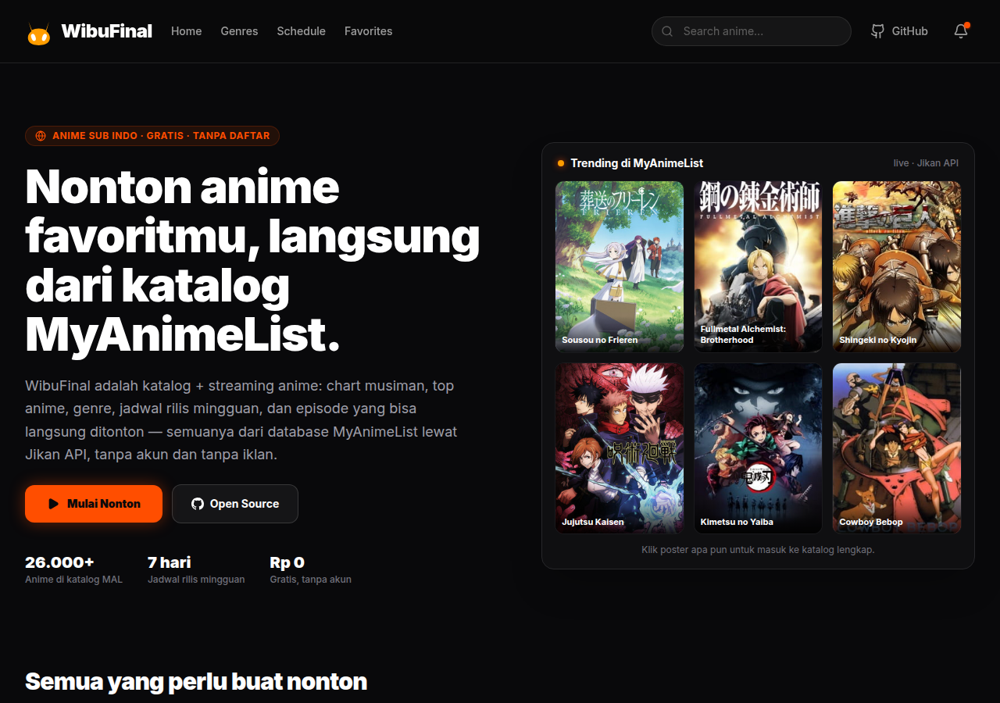
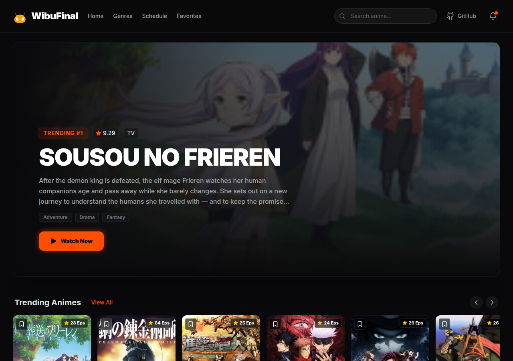
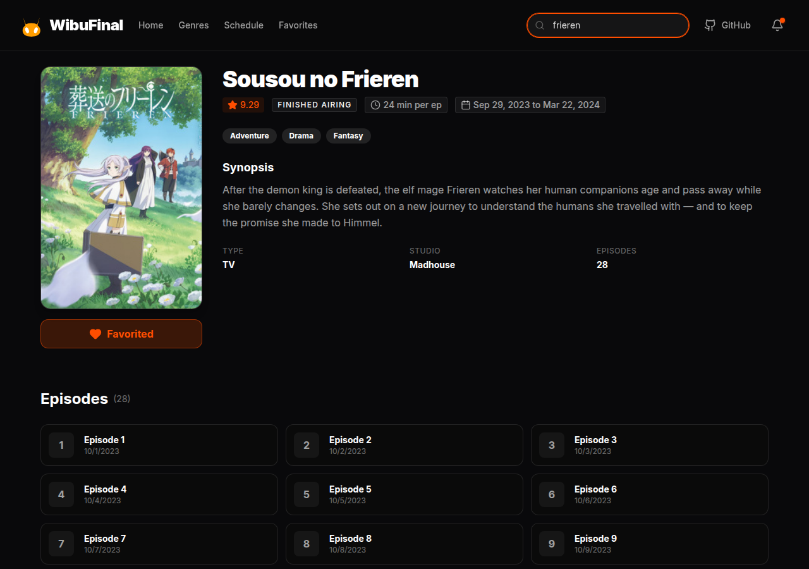
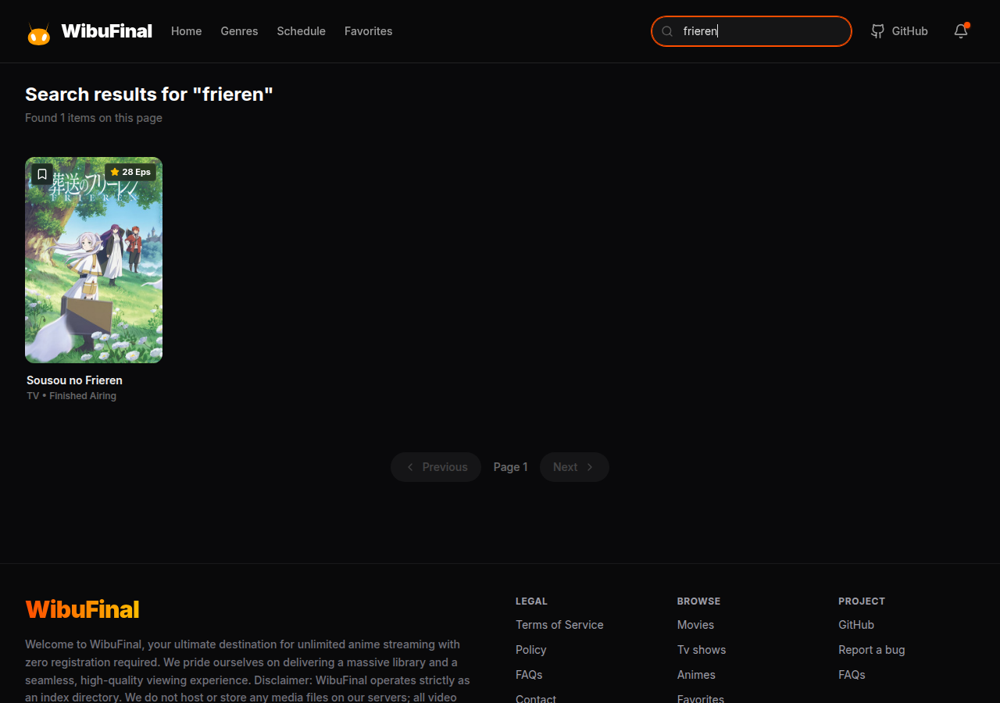
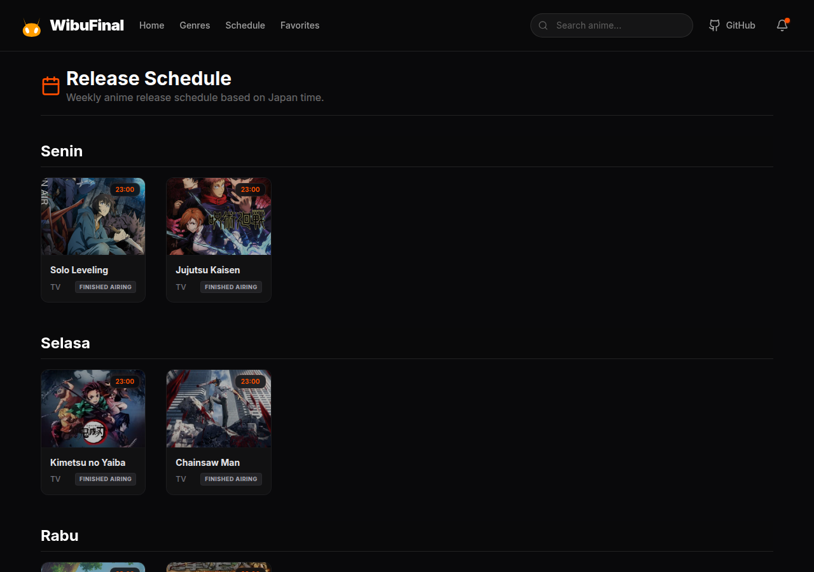
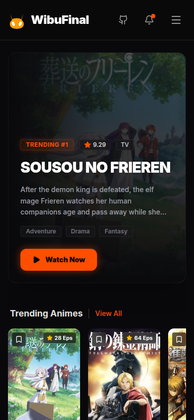

# 📺 WibuFinal

> Anime catalog + streaming front-end. Browse MyAnimeList data, check details, keep favorites, watch episodes — free, no account, no ads.


🔗 **Live:** https://wibufinal.pages.dev

---

## Demo

[](docs/demo.mp4)

▶️ **[Watch the video demo (mp4, silent)](docs/demo.mp4)** — landing → catalog → search → detail → episode. Recorded headless, so no audio. The catalog data in the video is fixture data and the posters are real MAL files served locally (see "Testing" below) because the sandbox that recorded it cannot reach the Jikan API or its CDN — the deployed site loads live data in a real browser.

| Landing | Catalog | Detail |
| --- | --- | --- |
|  |  |  |

| Search | Schedule | Mobile |
| --- | --- | --- |
|  |  |  |

---

## What it does

- **Catalog**: seasonal chart, trending, most popular, upcoming, top movies, and genre sections (Action, Romance, Comedy, Adventure, Sci-Fi, Fantasy).
- **Detail pages**: score, studio, synopsis, episode list, genres, favorite button.
- **Watch**: episode pages with an in-place player, prev/next navigation, full episode list.
- **Search** the full MyAnimeList catalog by title.
- **Schedule**: 7-day release schedule (Senin–Minggu) with airing times.
- **Favorites**: heart any anime; saved in this browser's localStorage. No login, no server.
- **Landing page** on first visit (SaaS-style, GitHub link top-right). Returning visitors go straight to the catalog.

## How it works

Fully static site (Next.js static export on Cloudflare Pages). There is no
backend: the browser fetches catalog data directly from the **Jikan API**
(the unofficial MyAnimeList REST API, `api.jikan.moe/v4`, no key, CORS
enabled). Posters come from `cdn.myanimelist.net`.

Routes: `/`, `/top`, `/popular`, `/upcoming`, `/movies`, `/tv-shows`, `/ongoing`, `/anime?id=`,
`/episode?e=`, `/genre?g=`, `/genres`, `/schedule`, `/search`, `/favorites`, `/terms`, `/policy`, `/faq`, `/contact`.
(Detail routes use query params because a static export cannot serve dynamic
`[slug]` routes — see `docs/architecture.md`.)

## Honest limitations

1. **Jikan rate limit: 3 requests/second, 60/minute per IP.** The client
   spaces requests and retries once on 429. First load shows skeletons while
   ~11 requests fill the home sections over a few seconds — by design.
2. **Streaming is not ours.** The episode player is an iframe to a
   third-party mirror (`animeplay.cfd`). It can be down, region-blocked, or
   show its own ads. The episode page says so.
3. **Catalog data is a cache of MyAnimeList**, hours old. Scores and airing
   status can lag MAL.
4. **Favorites live only in this browser.** Clearing site data deletes them.
5. **CORS dependency.** The browser calls `api.jikan.moe` directly. If Jikan
   ever drops its CORS headers, the catalog stops loading and the app shows an
   error state with a retry button — not a blank page.

## Local development

```bash
npm ci
npm run dev        # http://localhost:3000
npm run typecheck  # tsc --noEmit
npm run lint       # eslint
npm run build      # next build -> out/
npm run smoke      # serves out/, checks all 18 routes
```

## Docs

- [`PRD.md`](PRD.md) — product requirements (v1.1.0)
- [`docs/architecture.md`](docs/architecture.md) — stack, routes, why client-side
- [`docs/api.md`](docs/api.md) — Jikan endpoints, limits, response shapes
- [`docs/deployment.md`](docs/deployment.md) — Cloudflare Pages deploy
- [`docs/testing.md`](docs/testing.md) — CI, smoke, play-test, fixture note
- [`docs/diagram.html`](docs/diagram.html) — data-flow diagram (SVG)
- [`CHANGELOG.md`](CHANGELOG.md)

## License

MIT — see [LICENSE](LICENSE).
